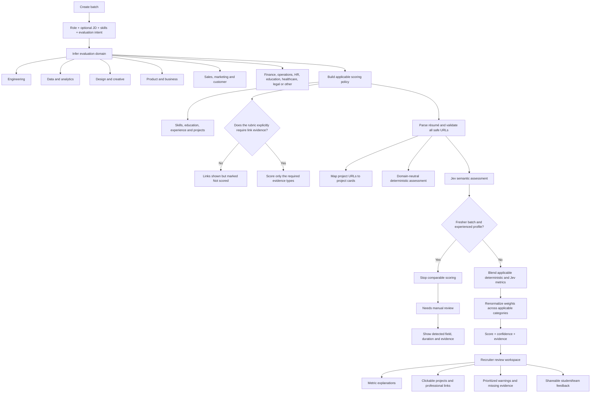

# Bulk ATS domain-aware evaluation flow

Date: 2026-10-16

## Problem statement

The current Bulk ATS presents technical terminology to recruiters and gives
developer-style evidence (GitHub, frameworks, deployments) influence outside
software roles. Placement teams also have to open the original résumé to find
links, interpret Jev metrics, and notice when an experienced candidate was
placed in a fresher batch. This creates unfair scores and avoidable manual work.

## Product principles

1. **The role rubric decides what is applicable.** A missing social profile or
   public project link is not a negative signal unless the JD, required skills,
   or evaluation intent explicitly makes that evidence necessary.
2. **Projects are domain-neutral by default.** Projects are judged on clarity,
   ownership, role relevance, outcomes, and evidence—not on framework count.
3. **No rubric mismatch is silently scored.** An experienced professional in a
   fresher batch is routed to manual review with their detected field and
   experience, and no comparable ATS score is published.
4. **Every visible score is explainable.** Recruiters can see what a metric
   measures, whether it affects the final score, and the evidence used.
5. **Links are actions, not checkmarks.** Every safely validated project,
   portfolio, social, credential, case-study, or other professional URL is
   directly openable from the candidate view.

## End-to-end flow

## P0 requirements and acceptance criteria

### Domain-aware scoring policy

- Given a data, product, finance, HR, operations, education, healthcare, legal,
  sales, marketing, customer-success, design, or general-business role, when a
  candidate has no GitHub account, then GitHub absence must not reduce the ATS
  score unless the configured rubric explicitly requires GitHub/repository
  evidence.
- Given no explicit professional-link requirement, `Links / proof` is displayed
  as `Not scored`, its weight is redistributed across applicable categories,
  and available links remain visible to the recruiter.
- Given an explicit link requirement, only the requested evidence categories
  affect the link score; unrelated social accounts do not.

### Domain-neutral project scoring

- Every project is evaluated on description depth, candidate ownership,
  relevance to the role rubric, outcomes/impact, and supporting evidence.
- Framework density, GitHub, and deployment availability cannot be universal
  requirements.
- Available validated URLs are mapped onto their project cards and are
  clickable. Projects without a safely attributable URL say `No project link
  found` and do not receive an automatic GitHub penalty.

### Fresher-mode mismatch gate

- Given a fresher batch, when Jev identifies material professional experience
  incompatible with fresher evaluation, the candidate becomes `Needs review`.
- No final comparable score/band is emitted for that candidate.
- The UI states the detected experience duration and candidate field.
- Internship, volunteering, campus leadership, and short apprenticeships must
  not automatically trigger the gate solely because they exist.

### Recruiter explainability and actions

- Every deterministic and Jev metric explains what it measures.
- The UI distinguishes metrics that affect the final score from informational
  diagnostics.
- Jev confidence is shown separately from the metric value.
- All validated URLs are listed with type, working/broken state, and an open
  action; unsafe schemes are never rendered as hyperlinks.

## Manual-work reductions included

- Automatic domain/evidence-policy selection from role, JD, skills, and intent.
- Automatic fresher/experienced mismatch routing.
- Consolidated clickable link inventory instead of reopening the résumé.
- Direct project-to-link mapping where attribution is reliable.
- Plain-language metric definitions, evidence provenance, and scoring impact.
- Prioritized review reasons rather than raw warning codes.

## Non-goals

- Automatic rejection or hiring decisions.
- Inferring protected characteristics or using them in scoring.
- Treating social-media presence as a proxy for competence.
- Guessing which project owns a URL when mapping confidence is low.
- Automatically changing a batch from fresher to experienced.

## Success metrics

- Zero score deductions caused solely by absent GitHub on roles without an
  explicit GitHub/repository requirement.
- 100% of validated professional URLs available as recruiter actions.
- 100% of Jev-confirmed fresher-mode mismatches routed to manual review without
  a comparable final score.
- At least 50% reduction in recruiter clicks back to the source résumé during
  candidate review, measured after instrumentation is added.
- Less than 2% false project-link attribution in a manually audited sample.

## Future considerations

- Recruiter-editable domain policy templates by college/program.
- Bulk actions for approving mismatch routing or moving candidates to another
  batch.
- Outcome-calibrated weights by domain after a representative labelled dataset
  and fairness audit are available.
- Side-by-side candidate evidence comparison and interview-kit generation.
