# Bulk ATS end-to-end user flow

This flow treats automated scoring as decision support only. A candidate is never automatically rejected or advanced; the recruiter owns the final decision and can see the evidence, warnings, and provider confidence behind every score.

```mermaid
flowchart TD
    A[Recruiter opens Bulk ATS] --> B{Signed in and staff role?}
    B -- No session --> B1[Sign in] --> B
    B -- Wrong role --> B2[Access denied; request recruiter or placement-staff role]
    B -- Yes --> C[Create or reopen screening batch]

    C --> D[Define batch name, role, optional evaluation intent, optional Job Description, skills, fresher or experienced mode]
    D --> D1{Role inputs valid?}
    D1 -- Missing batch name or role --> D2[Show field errors; keep draft]
    D1 -- Valid --> D0{Evaluation intent supplied?}
    D0 -- Yes --> D01[Store project or screening purpose; mark as external-provider context]
    D0 -- No --> D3
    D01 --> D3{Job Description supplied?}
    D3 -- Yes --> D5[Run JD quality meter: completeness, contradictions and risky criteria] --> E[Choose resume source]
    D3 -- No --> D4[Use role and skills; show reduced-context warning] --> E

    subgraph INGEST[Resume ingestion, up to 100 candidates per request]
      E --> F1[Upload PDF or DOCX files]
      E --> F2[Import CSV or XLSX with Google Drive or HTTPS resume links]
      F1 --> G[Validate count, extension, MIME signature, size, non-empty content]
      F2 --> H[Validate required columns, row count, URL syntax, Drive sharing URL]
      H --> H1[Fetch each link independently; revalidate every redirect]
      H1 --> H2{Resume source accessible?}
      H2 -- Private Drive file --> H4{Recruiter connected read-only Google Drive OAuth?}
      H4 -- No --> H5[Fail only that candidate; prompt recruiter to connect Drive]
      H4 -- Yes --> H6[Refresh short-lived access token and fetch through Drive API] --> I
      H2 -- No: expired, 404, HTML page, oversized --> H3[Fail only that candidate with actionable reason]
      H2 -- Yes or public --> I[Keep original Drive link and save a processing snapshot]
      G --> G1[Malware scan when ClamAV is configured]
      G1 --> J{Valid and safe candidate file?}
      J -- No: corrupt, encrypted, empty, wrong type, too large --> J1[Skip file with reason]
      J -- Yes --> K[Hash and deduplicate within batch]
      I --> K
      K --> K1{Duplicate file, candidate ID, or link?}
      K1 -- Yes --> K2[Skip duplicate; preserve existing result]
      K1 -- No --> L[Create candidate and enqueue independent job]
      L --> L1{Queue available?}
      L1 -- No --> L2[Mark failed; offer rerun after recovery]
      L1 -- Yes --> M[Queued]
    end

    subgraph EVALUATE[Isolated candidate evaluation]
      M --> N[Parsing]
      N --> N1{Text extractable?}
      N1 -- Corrupt or encrypted --> N2[Failed with parse reason]
      N1 -- Scan or nearly empty --> N3{OCR enabled and text recovered?}
      N3 -- No --> N4[Needs review: OCR dependency or manual inspection]
      N3 -- Yes --> O
      N1 -- Yes --> O[Structure identity, skills, education, experience, projects, links]
      O --> O1[Remove direct identity and contact fields from Jev payload]
      O1 --> P[Validate professional links and role-specific requirements]
      P --> Q[Deterministic scores and evidence]
      Q --> Q1[Skills]
      Q --> Q2[Education]
      Q --> Q3[Experience]
      Q --> Q4[Projects]
      Q --> Q5[Links and resume hygiene]
      Q --> R{Jev configured and reachable?}
      R -- Yes --> S[Jev semantic scoring with role, optional intent, optional JD and skills: demonstrated skills, relevance, project quality and complexity, education, hygiene]
      R -- No, timeout, rate limit, malformed response --> S1[Use deterministic scores; flag Jev unavailable and needs review]
      S --> T{Jev response complete and confident?}
      T -- No --> S1
      T -- Yes --> U[Blend deterministic and Jev scores with fresher or experienced weights]
      S1 --> U
      U --> V[Attach resume evidence to every metric and calculate confidence interval]
      V --> V1{DeepSeek feedback enabled and reachable?}
      V1 -- Yes --> V2[Send optional evaluation intent plus compact non-PII scorecard; generate capped contextual feedback only]
      V1 -- No --> V3[Use deterministic candidate brief]
      V2 --> W{Critical ambiguity or missing evidence?}
      V3 --> W
      W -- Yes --> W1[Needs review]
      W -- No --> W2[Completed]
      N2 --> X[Candidate terminal state]
      N4 --> X
      W1 --> X
      W2 --> X
    end

    X --> Y[Batch dashboard updates live: total, pending, completed, review, failed]
    Y --> Z{All candidates terminal?}
    Z -- No --> Y
    Z -- Yes, all failed --> Z1[Batch failed]
    Z -- Yes, mixed or successful --> Z2[Batch completed]

    Z1 --> AA[Recruiter filters and opens candidate details]
    Z2 --> AA
    AA --> AB[Review brief, category scores, source link, evidence, warnings, Jev confidence]
    AB --> AC{Human action}
    AC --> AC1[Add or edit human review notes]
    AC --> AC2[Rerun one failed or stale candidate]
    AC --> AC3[Retry failed subset after permissions or service recovery]
    AC --> AC4[Export auditable results]
    AC --> AC5[Record shortlist, hold, or not-shortlisted decision and job-related reason]
    AC --> AC6[Record interview, advanced, rejected, hired, or withdrew outcome]
    AC1 --> AA
    AC2 --> M

    AA --> AD{Privacy or retention action?}
    AD -- Delete batch --> AD1[Delete S3 objects first; retain batch if storage cleanup fails]
    AD -- Retain --> AD2[Restrict access by owner or admin; preserve audit events]
    AD2 --> AD3[Daily worker purges batches when retention period expires]
```

## Edge-case acceptance rules

- The request accepts at most 100 candidates. Larger sets are split into another upload/import instead of partially disappearing.
- Evaluation intent and Job Description are optional. Role name remains required. Intent can describe a project, hiring round, or screening purpose and improves semantic relevance; it does not add score points by itself.
- With no JD, intent plus explicit skills provides stronger context than a role name alone. Intent without a JD or skills remains lower-confidence and may require human review.
- Validation and processing are per candidate: one bad file, inaccessible Drive link, parser failure, Jev outage, or queue problem cannot block the other candidates.
- Normal public Google Drive sharing URLs are converted to a downloadable form. Private links use the batch owner's user-consented read-only OAuth grant; revoked/expired access fails only that candidate and prompts reconnection.
- Redirects are validated at every hop to prevent server-side request forgery.
- Duplicate detection is scoped to one batch, so a resume may legitimately be screened in a later role or hiring round.
- Final scores always expose category values and the weights used. Missing Jev output never becomes a confident-looking score; it triggers manual review.
- Automatic results assist review only. Human notes and downstream hiring decisions remain separate from the model score.
- Low confidence changes review priority and displays a score interval; it never reduces the score or automatically rejects a candidate.
- Jev receives the optional evaluation intent and a resume copy with direct header identity/contact fields removed. DeepSeek receives the optional intent plus only the compact scorecard, evidence, and warnings. Intent is treated as untrusted context, never as provider instructions.
- OCR is opt-in and requires Tesseract plus the configured language packs. Password-protected and malformed documents fail with actionable reasons.
- Recruiter decisions and interview outcomes form an explicit, auditable feedback dataset; they are not used for automatic self-training.
- Batch deletion and retention expiry delete stored S3 resumes before database records. If storage deletion fails, the batch is retained for recovery.
