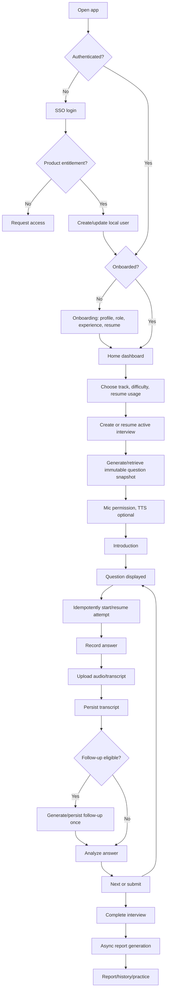
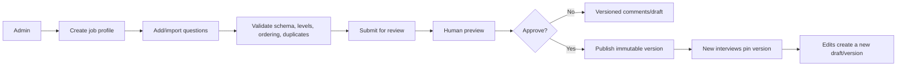
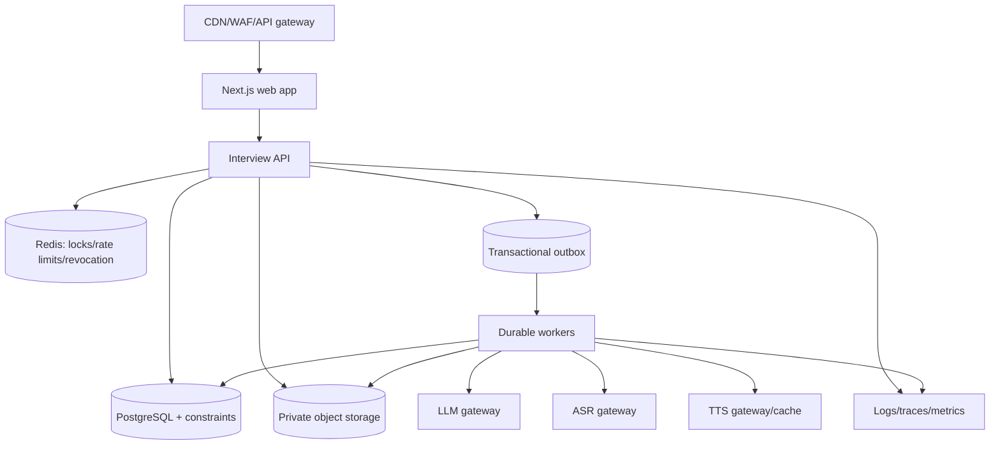

# Samvaad Saathi — Production Readiness Audit

**Audit date:** 2026-10-10  
**Scope:** `samvaad-saathi-frontend` (Next.js) and `samvaad_sathi_backend/backend/backend` (FastAPI/PostgreSQL), including interview, AI question generation, audio/transcription, analysis, reporting, resume, pacing, pronunciation, structure practice, authentication, analytics, and job-profile/admin APIs.

## Executive conclusion

The platform is not yet production-safe for a high-confidence mock-interview experience. The largest reliability problem is architectural: the browser is allowed to advance through an interview using a collection of loosely coupled client flags, while the backend persists question, attempt, transcription, follow-up, and analysis state through separate non-idempotent operations. Slow or failed requests therefore leave the browser in an ambiguous state. The current UI patches one symptom—releasing the Answer button after attempt-creation retries—but the durable fix must be a server-owned interview state machine with idempotent commands and a resumable client projection.

The most urgent findings are:

| Priority | Finding | Evidence | User/business impact |
|---|---|---|---|
| P0 | Interview answer availability depends on a fire-and-forget attempt request | Frontend disables Answer when `!currentAttemptId`; attempt creation is started in an effect and is not awaited by the page | Candidate can be trapped with Answer and Next disabled; last question can have no escape |
| P0 | Answer upload can be skipped when no attempt exists | Footer records audio but only uploads when `question_attempt_id` exists | Lost answer, false completion, inconsistent reports |
| P0 | Question generation and question delivery are not one atomic operation | Generation, TTS background work, supplements, and DB insertion are separate phases | Retries/two tabs can observe different question lists |
| P1 | Public SSO link is broken in the rendered unauthenticated page | Live route sweep rendered `http://localhost:3000/auth/undefined/auth/sso/login` | New users cannot start login |
| P1 | CORS production origin list contains a missing comma | `base.py` lines 82–84 concatenate two strings into one invalid origin | Valid production origin can fail preflight/auth requests |
| P1 | Attempt creation is not idempotent | `POST /interviews/question-attempts` always inserts a new row | Double clicks/retries/two tabs create duplicate attempts |
| P1 | Question status updates are not ownership-scoped at repository level | `update_status` queries by question ID only | A missed route check can mutate another user's question |
| P1 | Access revocation fails open when Redis is unavailable | `is_access_revoked()` returns `False` on Redis exceptions | Revoked users retain access until token expiry |
| P1 | Frontend stores complete question payloads in `localStorage` | `interview-session-storage.ts` writes generated questions client-side | Stale/cross-tab data can override server truth |
| P1 | Backend test suite cannot collect in the current environment | `python3 -m pytest -q`: 57 collected, 26 collection errors | Regressions can ship undetected |

## Verified user-flow map

### Candidate golden path

Alternate paths must be first-class: refresh/close/resume, token expiry, network loss, skip first/last question, zero/partial answers, failed transcription/analysis, reattempt, two tabs/devices, unsupported browser audio, denied/revoked mic, TTS outage, LLM outage, and report partial failure.

### Interviewer/admin flow

**Invariant:** publishing must never mutate the question set seen by an active or completed interview. The interview stores a profile version and question snapshot.

## Current and target architecture

Current code is a Next.js browser calling FastAPI routes, PostgreSQL, Redis, and external LLM/ASR/TTS providers, with partial S3 use. The production target should add a durable worker/outbox path:

Core decisions: server-owned state machine; idempotency keys on every mutation; immutable question-set versions; async AI/audio/report jobs; schema-validated AI output; private encrypted media; short-lived signed URLs; and explicit retry/skip/leave recovery in the UI.

## Required state machines

Interview: `created → generating → ready → in_progress → submitted → processing → completed`, with `cancelled`, `expired`, `failed_recoverable`, and `failed_manual_review` states.

Attempt: `available → started → recording → uploaded → transcribed → analyzing → analyzed`, with `skipped`, `failed_upload`, `failed_transcription`, `failed_analysis`, and `abandoned` states.

Use a unique key on `(interview_id, question_id, logical_attempt_number)` plus a client command ID. Repeating an HTTP command must return the original result, not create another row.

## Root cause of the button freeze

1. The page changes question.
2. An effect clears `currentAttemptId`.
3. It starts `POST /interviews/question-attempts` without awaiting it.
4. Footer receives `disabled=true` because `isStartingAttempt || !currentAttemptId`.
5. A lost response, auth refresh, remount, race, or backend delay strands the candidate.
6. The fallback eventually releases the button, but the recorder still has no durable attempt to attach its audio to.

Secondary races include duplicate starts after remounts, late attempt responses resetting Footer state, `hasAnswered` being set before upload is durably accepted, and analysis being chained through mutation callbacks rather than a durable status.

### Corrective implementation

1. Add an idempotent server command to start/resume an attempt and return its durable ID before recording.
2. On failure show `Retry sync`, `Skip`, and `Leave interview`; never silently accept an answer with no server owner.
3. Make audio upload return `202` and persist a processing state; poll/subscribe to attempt status.
4. Add a local answer outbox for reconnect-safe retries.
5. Make Next depend on attempt state (`analyzed`, `skipped`, or an explicit policy-approved `uploaded`), not booleans.
6. Rehydrate current question and attempt from the server after refresh.

## Why questions can change after publishing

The current system has job-profile rows, LLM generation, cached interview questions, follow-up insertion, and localStorage copies as separate sources of truth. Change paths include:

- published profile rows edited in place;
- response fields coming from structured LLM items while persisted rows come from `question_obj`;
- concurrent generation/retry paths;
- server follow-up insertion combined with client follow-up insertion;
- stale localStorage winning over the server on resume/reattempt;
- V1/V2 and tech/non-tech paths returning different contracts.

Fix with `job_profile_version` and immutable question-version rows. At interview creation, assign `question_set_version_id`; copy a stable snapshot with position/content hash; never edit snapshot rows; append follow-ups with server sequence and unique parent/strategy constraints; make localStorage cache only a cursor, never question content.

## Failure and edge-case catalogue

### Browser/device

Mic denied/revoked/busy, Bluetooth disconnect, browser codec differences, reload/back/forward, two tabs, mobile suspension, upload abort/partial body/timeout, unsupported codec, silent/oversized/corrupt audio, TTS autoplay blocked/expired/slow, focus loss in modals, keyboard-only recovery.

### Backend/concurrency

Duplicate starts/uploads/completes/follow-ups; DB commit followed by lost HTTP response; worker crash between transcript and analysis; Redis outage/stale locks; pool exhaustion; token expiry mid-recording; interview completion while a worker is processing; partial reports and contradictory versions.

### AI

Malformed or nonsensical JSON, prompt injection in resume/JD/transcript, hallucinated facts, bias/toxic feedback, language mismatch, low-confidence ASR, empty/filler/repeated/copied answers, provider timeout/rate limit/model drift/token overflow/cost spike, and score changes between retries.

Controls: provider gateway, bounded retries with jitter, circuit breaker, budgets, schema validation, deterministic seed/model metadata, redaction, confidence/provenance, human-review queue, and a clear AI-assisted disclaimer.

### Security/privacy

Enforce ownership in every repository query. Prefer HttpOnly secure cookies or a backend-for-frontend session over JS-readable token cookies. Enforce JWT issuer, audience, product entitlement, and key rotation. Encrypt media/resumes/transcripts/reports, use private buckets and short-lived URLs, never log sensitive content, validate file signatures, rate-limit expensive providers, audit admin publication/export/report access, and add CSRF protection for cookie-authenticated mutations.

## Backend and frontend coverage

Registered backend groups reviewed: users/auth, resume, resume builder, interviews V1/V2, audio, analysis, report, summary reports V1/V2, SSO/internal admin, TTS, speech pacing, job profiles V2, analytics V1/V2, and AI resume. The critical interview contract spans create, generate, attempt, transcribe, complete, resume, question/attempt listing, and report endpoints; these should be consolidated behind one versioned contract.

All declared frontend pages were visited in the local browser. Unauthenticated access consistently redirected protected routes to `/auth/signup`. The public auth page rendered, but its Continue link was `/auth/undefined/auth/sso/login`. Covered routes include `/`, `/auth/signup`, `/home`, `/onboarding`, `/interview-start`, `/interview`, `/interview-completed`, `/reattempt-interview`, `/history`, `/report-summary`, `/practice`, all `control-your-pace` pages, pronunciation pages, structure pages, all `ai-resume` pages, and `/profile`.

An authenticated end-to-end browser run still requires a working SSO/auth-service environment and test account. That must be a release gate, not replaced by route compilation.

## Prioritized remediation plan

### First 48 hours

1. Fix SSO URL construction and add an unauthenticated href smoke test.
2. Replace attempt-start gating with an idempotent server command and retry/skip/leave recovery.
3. Add visible pending/error/retry states for upload, transcription, analysis, and completion.
4. Stop treating localStorage as authoritative question content.
5. Add database uniqueness and transaction boundaries for attempts/follow-ups.
6. Fix the CORS missing comma and test every production origin with preflight requests.
7. Rotate any real-looking provider credentials in local environment files and prevent `.env` commits.

### First two weeks

1. Implement state machines, idempotency keys, immutable job-profile versions, and snapshotting.
2. Move audio/AI/report work to durable workers with outbox, retry, and dead-letter handling.
3. Add authenticated Playwright golden-path tests with network fault injection.
4. Pin a supported Python version, install dependencies from a lockfile, and make clean-checkout CI run unit/contract/integration/migration tests.
5. Add traces linking interview/question/attempt/command/provider IDs without sensitive payloads.

### Before scale

Load-test simultaneous creation/uploads/retries/provider outages; security-test IDOR, auth refresh/revocation, CORS/CSRF, upload abuse, prompt injection, data leakage, and admin authorization; define SLOs and operational runbooks; alert on candidate lockouts, upload failures, transcription latency, AI failures, duplicate commands, and report backlog.

## Release gates

- Zero P0 issues.
- No candidate can become permanently blocked from Answer, Next, Skip, Submit, Retry, or Leave.
- Repeating a command 10 times creates one logical attempt and one follow-up.
- Refresh at every interview step reconstructs the same server state.
- Published edits cannot change active/completed interviews.
- Cross-user IDs return safe 404/403 responses everywhere.
- AI/provider failure produces a deterministic fallback or resumable pending state.
- CI installs cleanly and executes the full suite.
- Production dashboards expose lockout, provider, duplicate-command, and backlog metrics.

