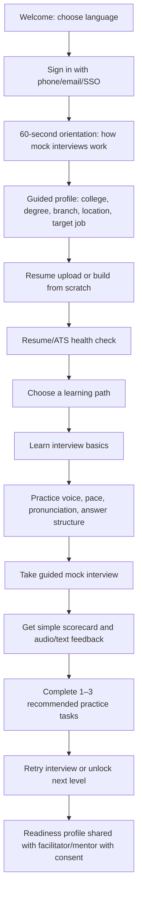
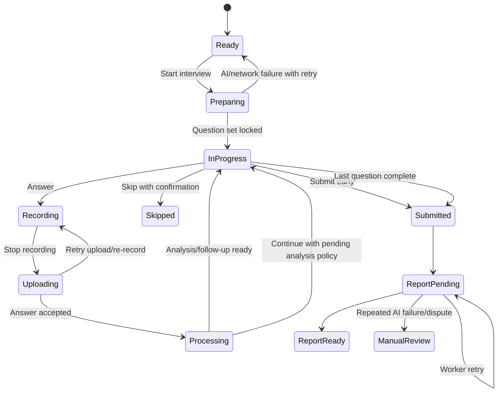
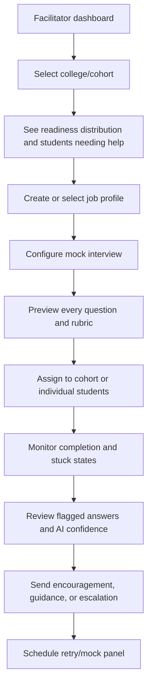
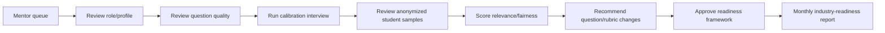
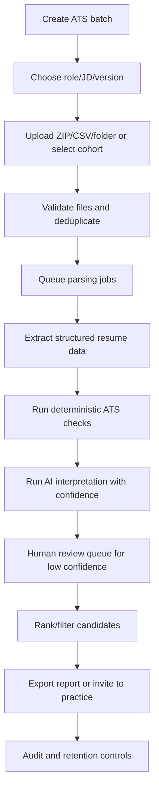
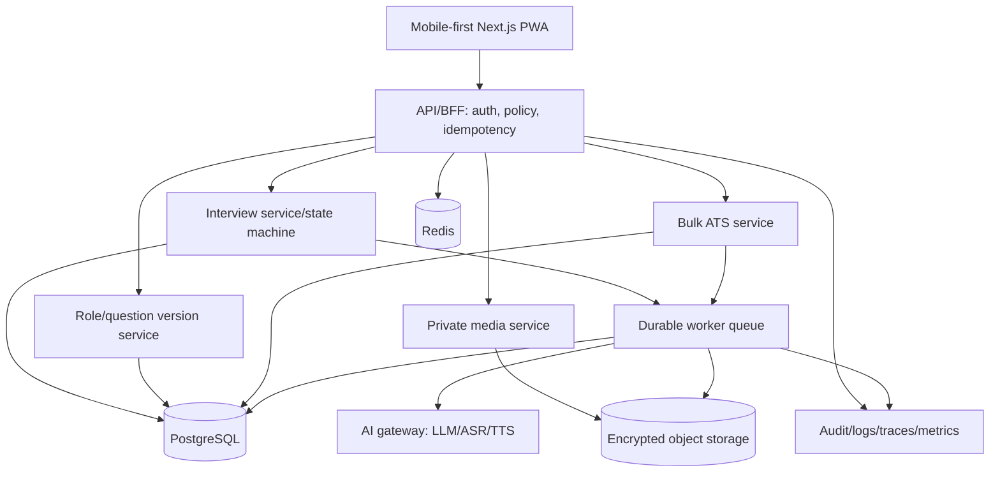

# Samvaad Saathi — Tier 3 India Product Blueprint

**Product goal:** Help a student from a Tier 3 college or backward area become interview-ready through simple, repeatable, explainable practice in their language and on their device.

**Primary principle:** The product must feel like a patient coach, not an examination portal. Every screen should answer three questions: “What do I do now?”, “Why does it matter?”, and “What happens if something goes wrong?”

## 1. Product strategy

### Target student

The primary student may have:

- limited exposure to interview formats, English, computers, and professional vocabulary;
- an entry-level Android phone, shared device, weak network, or intermittent electricity;
- a resume that is incomplete, unstructured, or not ATS-readable;
- anxiety about speaking and fear of being judged;
- little understanding of what technical or HR interviewers expect;
- a need for Hindi, Hinglish, regional-language explanations, and audio guidance.

### Product promise

“In small guided steps, Samvaad Saathi will help you understand the interview, practice speaking, improve your resume, and show you exactly what to improve next.”

### Product pillars

1. **Guided confidence:** one action per screen, examples before evaluation, plain language, audio instructions.
2. **Reliable practice:** an interview never loses a question or answer because of refresh, network failure, AI failure, or duplicate clicks.
3. **Human-supported AI:** AI gives fast practice and feedback; facilitators and impact mentors provide context, encouragement, and escalation.
4. **Industry relevance:** job-profile question banks, mentor review, ATS checks, and employer-aligned readiness signals.
5. **Low-bandwidth inclusion:** mobile-first, resumable, compressed media, graceful degradation, and language support.

## 2. Role model

| Role | Primary job | Permissions |
|---|---|---|
| Student | Practice, improve, understand feedback, become job-ready | Own profile, resume, interviews, answers, reports |
| Facilitator | Create cohorts, assign practice, create/review mock interviews, support students | Assigned cohort and role-profile scope; cannot alter completed student records |
| Impact Mentor | Validate industry relevance and advise on readiness | Read assigned anonymized/consented samples; comment, rubric, recommend changes |
| Admin | Govern platform, users, roles, security, analytics, ATS operations | Organization/platform scope with audited privileged actions |
| AI worker | Generate, transcribe, analyze, recommend | No independent authorization; only scoped jobs with traceable outputs |

Every role needs explicit authorization in the backend. Do not represent Facilitator, Mentor, and Admin as one generic `is_admin` flag.

## 3. Student experience

### Student flow

### Student home screen

Never present a dashboard full of unexplained metrics. Show:

- **Continue where you stopped**;
- one primary action: “Start today’s practice”;
- readiness journey: Resume, Speaking, Interview, Job readiness;
- a small “Your next improvement” card;
- language switcher and audio help;
- “Need help?” facilitator contact or WhatsApp/call escalation.

### Student modules already in the product

The following existing capabilities remain in the product, but are reorganized into a guided journey:

1. **AI resume:** upload, parse, extract skills, preview, improve hygiene, score, build/edit, download, and sync to profile.
2. **Mock interviews:** role/difficulty selection, resume-aware questions, job-profile questions, technical/non-technical tracks, audio answers, transcription, adaptive follow-ups, pacing/pause/communication/domain analysis, completion, reports, history, and reattempts.
3. **Control your pace:** level intro, levels, timed voice practice, report, readiness unlocks.
4. **Pronunciation practice:** guided words/questions, TTS model answer, recording, practice report.
5. **Structure your answer:** STAR/C-T-E-T-D or role-specific structures, section-by-section recording, hints, and feedback.
6. **Progress/history:** previous interviews, reports, scores, action items, and improvement trend.
7. **AI explanations:** every score must include an example of what the student said, what a stronger answer could contain, and one next action.

### Student interview flow

### Rules for a student-friendly interview

- Before the first question, play a 30-second explanation and show a sample answer.
- Use one clear “Answer” button, one “Stop” button, and one “Skip” button.
- Never show a disabled button without the reason and a recovery action.
- If the network fails, save the recording locally, show “Your answer is safe,” and retry.
- If AI fails, preserve the answer and continue with a deterministic fallback or pending analysis.
- Allow the student to leave safely and resume from the same question.
- Show pronunciation, pacing, and content feedback separately so a weak English accent is not treated as weak knowledge.
- Use local-language explanations even when the target interview language is English.

## 4. Facilitator experience

Facilitators are the operational bridge between students and the platform. Optimize for cohort management and intervention, not engineering complexity.

### Facilitator flow

### Facilitator capabilities

- Create role profiles from role template, JD, syllabus, or manually.
- Add/edit questions, difficulty, topic, expected answer themes, language, and time limit.
- Preview the exact published question set and rubric.
- Assign interview windows, cohorts, attempt limits, and accessibility accommodations.
- See completion, dropout, stuck-answer, upload-failure, and low-confidence-AI queues.
- Review transcripts and reports only for assigned students and with an audit trail.
- Override a failed technical state—never silently alter a student’s score.
- Mark an attempt as “technical issue,” “student skipped,” or “mentor review required.”
- Export cohort readiness summaries with minimum necessary student data.

### Facilitator interview-builder flow

1. Select role: e.g. Customer Support Associate, Junior Developer, Data Entry, Sales Executive.
2. Choose target audience and language support.
3. Add job description or select a role template.
4. Generate a draft question set.
5. Edit every question and expected skill.
6. Configure rubric: content, communication, structure, pace, pronunciation; keep knowledge separate from accent.
7. Preview as a student on mobile and slow network.
8. Submit for mentor review or publish if permitted.
9. Assign a versioned interview to a cohort.

**No published interview may change in place.** Editing creates a new draft/version. Active and completed attempts keep their original snapshot.

## 5. Impact Mentor experience

Impact Mentors are advisory partners for industry readiness, not everyday operators.

### Mentor flow

### Mentor tools

- Role and industry competency frameworks.
- Question quality rubric: relevance, clarity, difficulty, cultural fairness, entry-level appropriateness.
- Calibration mode: multiple mentors score the same answer and compare variance.
- AI feedback review: flag hallucination, bias, irrelevant criticism, or accent discrimination.
- Student sample review with consent and anonymization.
- Recommendation log linked to profile/question version.
- Employer feedback and placement-outcome loop.

Mentors must not see more student data than needed. Access expires, is scoped, and is logged.

## 6. Admin experience

### Admin areas

1. **Identity and access:** organizations, colleges, cohorts, roles, permissions, SSO, revocation, audit logs.
2. **People and cohorts:** bulk import, deduplication, enrollment, facilitator assignment, consent status.
3. **Role library:** published profiles, version history, review workflow, rollback/archive.
4. **Interview operations:** active sessions, stuck sessions, failed jobs, provider health, support actions.
5. **Bulk ATS:** upload many resumes, parse, score, shortlist, export, and audit.
6. **Analytics:** adoption, completion, improvement, college/cohort comparisons, equity and quality checks.
7. **AI governance:** model versions, prompt versions, cost, latency, failures, confidence, flagged outputs.
8. **Security/compliance:** retention policies, data deletion/export, suspicious access, key rotation, incident logs.

## 7. Bulk ATS system

### Admin ATS flow

### ATS batch requirements

- Accept PDF/DOCX/TXT with virus scanning, MIME/signature validation, size limits, and safe filename handling.
- Map each resume to a student only after explicit identity matching; never rely on filename alone.
- Parse into normalized fields: name, contact, education, skills, projects, experience, links, certifications, languages.
- Compare against a versioned JD/profile using explainable categories: must-have skills, preferred skills, evidence, education, experience, missing information, and link validity.
- Keep **eligibility filters separate from ranking**. A missing keyword must not automatically reject a student.
- Show evidence snippets for every score and allow a human to override with reason.
- Support batch progress, pause, retry failed files, download partial results, and resume after admin refresh.
- Never expose one college’s student resumes to another organization.
- Default to anonymized ranking where feasible to reduce name, gender, location, and college bias.
- Store model/prompt/profile version with every result.
- Allow student correction and re-run; retain the original result for audit.

### ATS score model

Use a transparent weighted score, configurable per role:

`ATS readiness = 30% must-have evidence + 20% role skills + 15% project evidence + 15% education/eligibility + 10% experience + 10% resume quality`

Do not call it “selection probability.” Call it “match/readiness signal,” show uncertainty, and require human review for hiring decisions.

## 8. Security and integrity design

### Authentication and authorization

- Use centralized SSO/OIDC with issuer, audience, product entitlement, expiry, nonce/state, and key rotation checks.
- Prefer HttpOnly, Secure, SameSite cookies through a backend-for-frontend; do not expose refresh tokens to JavaScript.
- Model permissions as `organization → college → cohort → assignment`, not a single admin boolean.
- Enforce ownership in repository queries, not only frontend guards.
- Require step-up authentication for exports, bulk ATS, role publication, impersonation, and access changes.
- Audit every privileged action with actor, scope, target, reason, timestamp, and before/after version.

### Interview integrity controls

“No tab switching” should be a deterrent and a signal, not a brittle absolute promise. Browsers cannot guarantee detection, and strict blocking harms accessibility and unreliable-device users.

Recommended policy:

1. On interview start, disclose integrity rules and obtain consent.
2. Track `visibilitychange`, `blur/focus`, fullscreen exit, refresh/reconnect, device changes, and unusual timing.
3. Show a warning on the first event; log subsequent events with timestamps.
4. Pause the timer while the page is hidden only if the interview policy allows it; otherwise record elapsed time honestly.
5. Never disable the browser refresh button. Instead, persist state server-side and resume safely.
6. On refresh, restore the same question and attempt; do not punish a technical refresh.
7. For high-stakes assessments, combine signals with human review rather than auto-failing.
8. Provide an accommodation path for screen readers, low vision, network instability, and shared devices.

Other safeguards:

- signed, short-lived interview session tokens;
- one active attempt per question and idempotent commands;
- server-owned timer with clock-skew tolerance;
- optional camera/proctoring only with explicit consent, legal review, and a non-camera alternative;
- watermark/export controls for reports;
- rate limits and abuse detection;
- encrypted media, private storage, signed URLs, retention/deletion policy;
- prompt-injection defense for resumes, JDs, transcripts, and mentor content;
- file scanning and resource limits;
- no sensitive transcript/audio content in logs.

## 9. AI quality and human intervention

AI must be treated as an assistant with bounded authority.

| AI function | Allowed authority | Human fallback |
|---|---|---|
| Question generation | Draft questions only; must pass schema and policy checks | Facilitator/mentor edits before publish |
| Transcription | Produce transcript with confidence | Student can retry; facilitator can mark technical failure |
| Scoring | Generate explainable provisional scores | Human review for low confidence, dispute, or high-impact decision |
| Follow-up generation | Create one scoped follow-up per eligible parent | Deterministic fallback or skip |
| Resume parsing | Extract candidate-provided facts | Student correction and confirmation |
| ATS matching | Advisory readiness signal | Human shortlist decision; audit override |
| Recommendations | Suggest next practice | Student/facilitator chooses action |

Every AI output stores model, prompt, input-reference IDs, schema version, confidence, latency, cost, and safety flags.

## 10. Technical architecture

### Non-negotiable data model concepts

- `user`, `organization`, `college`, `cohort`, `role_assignment`;
- `job_profile`, `job_profile_version`, `question_version`;
- `interview`, `interview_question_snapshot`, `question_attempt`;
- `recording`, `transcription`, `analysis_result`, `follow_up`;
- `report`, `practice_recommendation`, `mentor_review`;
- `ats_batch`, `ats_document`, `ats_result`, `ats_override`;
- `audit_event`, `consent`, `retention_policy`, `ai_run`.

All mutations need an idempotency key. All published content is versioned. All heavy work is durable and resumable.

## 11. Build roadmap

### Phase 0 — Reliability foundation

- Fix auth, CORS, dependency/CI health, ownership checks, token handling, and observability.
- Implement server-owned interview/attempt state machines.
- Eliminate authoritative localStorage question state.
- Add idempotency, retry, resume, and “never silently disabled” UI rules.

### Phase 1 — Student MVP

- Guided onboarding and language support.
- Resume upload/build plus ATS health check.
- Role/difficulty selection and immutable interview question set.
- Audio interview with transcription, basic content/communication feedback, report, history, and reattempt.
- Pacing, pronunciation, and answer-structure practice.

### Phase 2 — Facilitator operations

- Cohorts, assignments, role builder, question preview, student support queue, and intervention notes.
- Facilitator-authored questions and published version workflow.

### Phase 3 — Mentor and industry readiness

- Calibration, anonymized sample review, competency frameworks, bias/quality flags, and mentor recommendations.

### Phase 4 — Admin and bulk ATS

- Bulk import, ATS batches, role-specific scoring, human review, exports, audit, and retention controls.

### Phase 5 — Scale and intelligence

- Offline/PWA recording queue, regional languages, employer outcome feedback, adaptive learning plans, and controlled model experimentation.

## 12. Success metrics

### Student outcomes

- 70% of new students complete onboarding within 10 minutes.
- 60% complete their first mock interview within 48 hours.
- Less than 1% of interview sessions end in an unrecoverable technical lockout.
- At least 50% complete one recommended practice action after a report.
- Median time from first login to first successful answer under 15 minutes.
- Improvement in interview rubric score after three attempts, measured by versioned rubric.

### Operational outcomes

- 95% of assigned interviews are completed or have a recorded reason for non-completion.
- Facilitator can identify every stuck student within one working day.
- 99.9% of accepted answer commands are preserved exactly once.
- 95% of ATS documents complete within the declared batch SLA.
- 100% of published role/question changes have reviewer, version, and audit data.

### Quality and fairness

- Mentor agreement on question relevance and scoring rubric above an agreed threshold.
- AI low-confidence rate monitored by language, college, device, and network type.
- No statistically unexplained disadvantage from accent, gender, college, geography, or language support.

## 13. Definition of done for launch

- Student can refresh, reconnect, close, reopen, and resume without losing the question or answer.
- No action button remains disabled indefinitely or without an explanation/recovery path.
- Published questions never mutate inside active or completed interviews.
- Facilitator can create and preview an interview before assigning it.
- Mentor can review the rubric and flag AI quality issues.
- Admin can run a bulk ATS batch with retry, partial results, human override, and audit history.
- Cross-organization access tests pass.
- AI, ASR, TTS, Redis, database, and queue outages produce safe, resumable states.
- Security, privacy, consent, retention, accessibility, and incident-response policies are approved.

