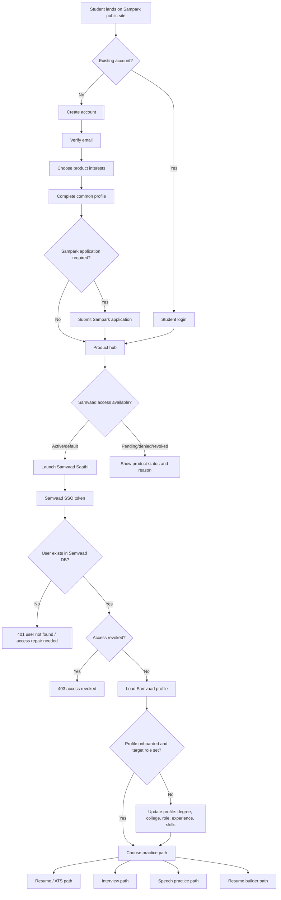
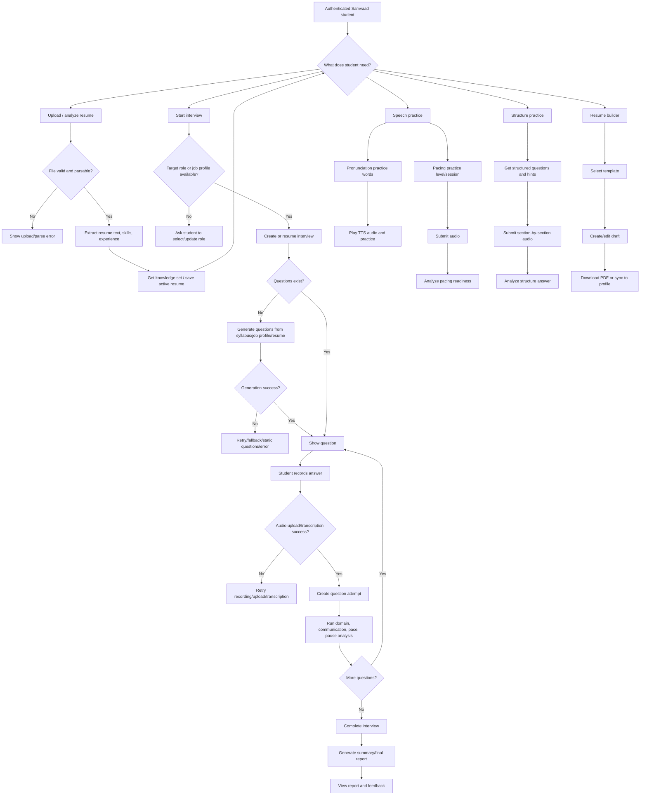
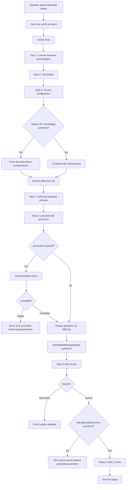
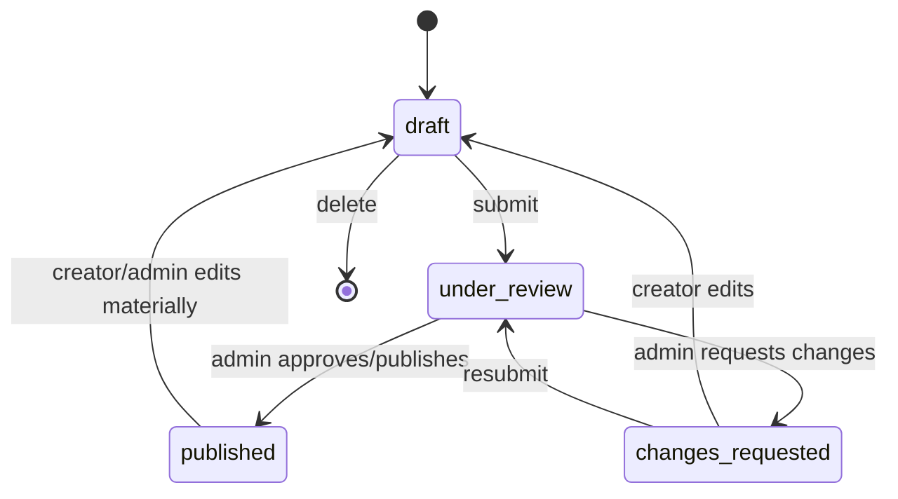
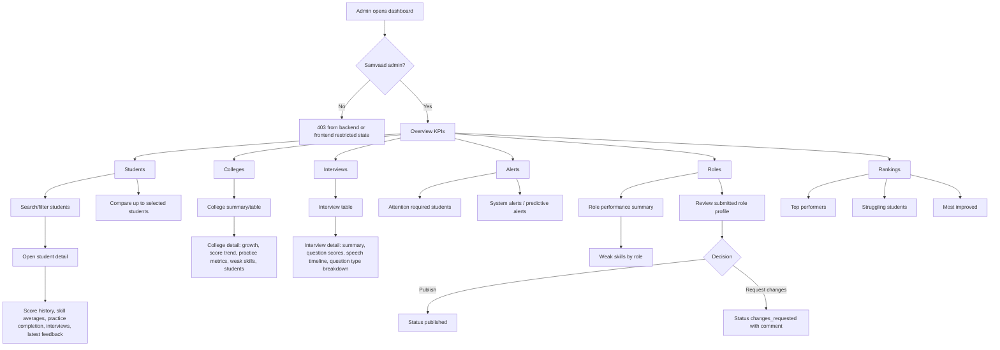
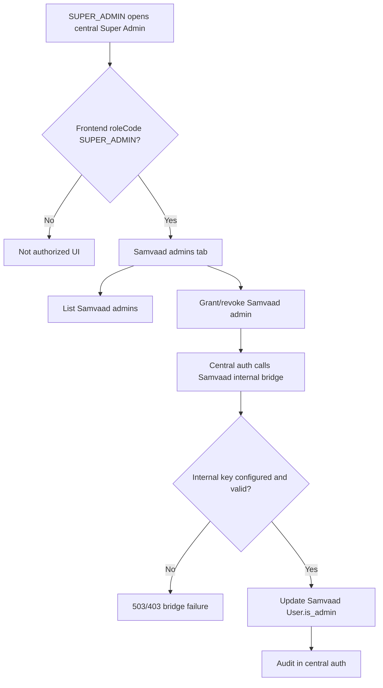

# Samvaad Saathi Backend Roles And User Flows

PM view based on the Samvaad backend in `backend/backend/src/api/routes/*` and the Sampark/Samvaad frontend in `/Users/armasahar/Desktop/sampark-saathi frontend`.

## Scope Notes

- "Patient" is treated as the student/learner/candidate end user.
- Samvaad backend role enforcement is intentionally simple:
  - `Authenticated student/user`: any valid SSO or legacy JWT user present in Samvaad DB.
  - `Samvaad admin`: `user.is_admin = true` or email in `ADMIN_EMAILS`; can read cross-student analytics and review job profiles.
  - `Internal super-admin bridge`: service-to-service key used by central auth/super-admin tooling to grant or revoke Samvaad admin status.
  - `Background worker/AI services`: async question generation, parsing, TTS, transcription, analysis.
- The frontend has broader operator roles (`ADMIN`, `PLACEMENT_COM`, `PROGRAM_MANAGER`, `FACILITATOR`, `SUPER_ADMIN`), but Samvaad backend does not distinguish all of them directly. They enter Samvaad through the same `/api/samvaad/*` proxy and are gated in Samvaad as normal user vs Samvaad admin.

## Role Map

| Role | Backend authority | Main frontend surfaces | Core outcomes |
| --- | --- | --- | --- |
| Student / learner / candidate | Valid token and matching Samvaad `User` row | Student registration, product hub, external Samvaad app launch | Complete profile, upload resume, choose role, practice interviews, submit audio answers, get feedback/report |
| Samvaad admin / PM dashboard user | `get_current_admin_user` or `is_admin_user` | `/dashboard/samvaad`, students, colleges, interviews, alerts, roles, rankings | Monitor adoption, identify struggling students, inspect interviews, manage/review role/job profiles |
| Role creator | Any authenticated Samvaad user can create/edit drafts; admin-only review endpoint for status decisions | `/dashboard/samvaad/roles`, `/roles/new` | Create job profile, upload JD/knowledge questions, generate/edit question bank, submit for review |
| Super admin operator | Central auth service; Samvaad internal key bridge | `/dashboard/super-admin` | Grant/revoke Samvaad admin access and audit entitlement changes |
| System worker / AI services | Internal services plus queue | No direct UI except status polling | Parse files, transcribe audio, generate questions, analyze responses, produce reports |

## End-To-End Student Flow

### Student Entry Edge Cases

| Landing point | Scenario | Expected product behavior |
| --- | --- | --- |
| Registration | Email already exists | Route to login/recovery instead of creating duplicate identity |
| Registration | Email verification not complete | Resume from `VERIFY_EMAIL`, allow resend code |
| Product hub | Profile incomplete | Block or warn for products needing profile; show continue onboarding |
| Product hub | Samvaad active | Launch Samvaad directly |
| Product hub | Sampark/CodeGuru pending or denied | Show status and decision reason; allow request again where allowed |
| Samvaad SSO | Invalid/expired token | Return 401 and force re-login/refresh |
| Samvaad SSO | Access revoked after token issuance | Return 403 via local revocation check |
| Samvaad SSO | Token valid but no Samvaad user row | Return 401; needs account sync/repair |

## Student Samvaad Practice Flow

### Student Interview Edge Cases

| Stage | Possible scenario | Recommended handling |
| --- | --- | --- |
| Profile | Missing target role and no track supplied | Do not silently default; ask student to select role |
| Profile | Target role outside fixed enum but job profile exists | Allow job profile driven interview if backend supports it |
| Resume | Empty, corrupted, password-protected, unsupported, oversized file | Show actionable upload error and preserve prior active resume |
| Resume | Parser extracts weak/incorrect skills | Let student edit final profile/resume before interview generation |
| Interview start | Existing in-progress interview | Resume instead of creating duplicate session |
| Interview start | Completed interview selected | Offer view report, retry/new attempt, or start new interview |
| Question generation | LLM unavailable or timeout | Use static fallback where available; otherwise show retry |
| Question generation | No job-profile questions at chosen level | Fallback to other generated/static questions or ask admin to add questions |
| Recording | Browser mic denied in frontend | Show permission instructions and keep question state |
| Recording | Audio upload missing/invalid format/too large | Block analysis, allow re-record/upload |
| Transcription | Whisper returns empty or low-confidence text | Ask for retry and optionally allow manual answer text if product supports it |
| Analysis | Domain/communication/pace/pause service fails | Store attempt state, surface partial results, retry failed analysis |
| Report | Report requested before completion | Explain report is available after interview completion |
| Report | Report generation fails | Keep interview completed, allow regeneration |
| Analytics | Student requests another student's analytics | Return 403 unless Samvaad admin |

## Role Creator / Job Profile Flow

### Job Profile Status Flow

### Role Creator Edge Cases

| Stage | Scenario | Expected behavior |
| --- | --- | --- |
| Draft restore | Local draft exists but backend profile deleted | Clear stale draft and return to roles list |
| File upload | JD or question file is unsupported/empty | Show parse error; keep typed form values |
| Skill extraction | AI unavailable | Let creator continue with manual skills |
| Generation | Queue returns `failed` or `not_found` | Show retry and allow manual question creation |
| Generation | Zero questions generated | Require manual additions before submit |
| Question edit | Invalid difficulty/level | Reject with validation and keep previous version |
| Submit | No questions attached | Backend rejects submit; frontend should show "add questions first" |
| Review | Non-admin tries review endpoint | 403 administrator access required |
| Delete | Deleting published profile used by interviews | Backend currently allows delete endpoint; PM should decide archive vs hard delete |

## Samvaad Admin / PM Dashboard Flow

### Admin Edge Cases

| Scenario | Expected behavior |
| --- | --- |
| Admin token valid but `is_admin` false and email not allow-listed | 403 for cross-student analytics |
| Dashboard filters have no data | Render empty state, not fake metrics |
| Date range excludes all interviews | Show zero KPIs and empty charts |
| Student detail ID does not exist | 404/empty detail state |
| Interview detail ID does not exist or belongs to inaccessible data | 404/403 |
| Search query empty | Return default recent/top data or require input consistently |
| Role review without admin comment when requesting changes | Frontend should require useful comment; backend accepts optional payload shape depending endpoint |
| Analytics endpoint returns partial/null scores | UI should display `N/A`, not rank as zero unless explicitly defined |

## Super Admin Access Management Flow

### Super Admin Edge Cases

| Scenario | Expected behavior |
| --- | --- |
| User email not found in Samvaad DB | Internal bridge returns 404; admin must ensure user has logged into Samvaad/synced |
| Bridge secret missing | 503 configuration error |
| Invalid bridge secret | 403 |
| Revoked admin still has an active frontend session | Next Samvaad admin-gated request should fail unless allow-listed by env |

## Backend Endpoint Groups By Flow

| Flow | Backend routes |
| --- | --- |
| Identity/profile | `/auth/sso/*`, `/me`, `/users/profile`, `/internal/super-admin/*` |
| Resume | `/resume`, `/resume/me`, `/resume/knowledge-set`, `/resume/original`, `/resume/final`, `/resume/active`, `/ai-resume/*`, `/resume-builder/*` |
| Interviews | `/interviews`, `/interviews/{id}/questions`, `/interviews/{id}/attempts`, `/v2/interviews/*`, `/audio`, `/analysis/*` |
| Reports | `/final-report/{interview_id}`, `/summary-report/*`, `/v2/summary-report/*` |
| Practice | `/pacing-practice/*`, `/tts`, `/v2/pronunciation-practice/*`, `/v2/structure-practice/*` |
| Job profiles / roles | `/v2/job-profiles/*`, `/v2/job-profile-questions/*` |
| Dashboard analytics | `/analytics/*`, `/v2/analytics/*` |

## PM Gaps / Decisions To Close

1. Decide whether Samvaad should understand frontend operator roles (`PROGRAM_MANAGER`, `FACILITATOR`, `PLACEMENT_COM`) or continue with a single Samvaad-admin flag.
2. Decide whether "delete role" should become archive/disable when a role has historical interviews.
3. Define fallback behavior for failed AI generation/transcription/analysis: retry only, manual input, or static content fallback.
4. Define exact empty-state copy for no resume, no target role, no interview history, no analytics data.
5. Decide whether student-facing Samvaad should support manual text answers when audio fails.
6. Add product analytics events for each major drop-off: registration, product launch, profile, resume, role selection, interview start, first answer, interview completion, report view, practice follow-up.

