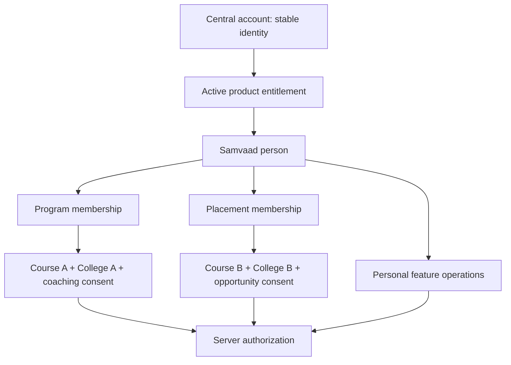

# Staff identity, roles and relationships — build 11

19 October 2026. Implemented in candidate branches; not deployed and no production staff assignments changed. This work takes priority over other product features.

## Authority model

| Layer | Owner | Meaning |
|---|---|---|
| Central identity | Central auth | Stable user ID, credentials, active/deleted state, current platform role |
| Product entitlement | Central auth | Whether that account may enter Samvaad |
| Product administrator | Explicit product grant or verified central authority | Administration; never an ordinary team role |
| Team membership | Samvaad | One person may have several independent active memberships |
| Responsibility | Samvaad membership | Lead, creator, facilitator, senior/junior facilitator, program manager, placement staff, recruiter, partnership staff, member |
| Personal operations | Samvaad administrator | Explicit per-person feature operations; may grant interview authoring to a facilitator without promoting them to admin |
| Data scope | Samvaad membership + Sampark enrollments | Paired courses and colleges, with the responsibility's consent purpose |

A display role, organizational team name, token label, or selected frontend filter never creates global authority. Academic course scope is separate from organizational Program/Placement/Partnership teams.

## Implemented behavior

1. Reserved administrator/super-administrator labels cannot be assigned through ordinary team creation/update. Supported responsibility aliases normalize to canonical names; legacy response labels remain readable.
2. Locally issued token role labels cannot elevate a person to global admin/super admin. New local staff tokens carry STAFF as authority classification; all membership roles are returned separately for display and capability decisions.
3. SSO callback no longer permanently promotes local admin flags from a transient central token role. Existing explicit/legacy product-admin grants are not silently demoted or rewritten; previously auto-promoted flags require review before central rollout.
4. Creator and ATS guards require a live product membership when a database session exists. Removing membership blocks access despite a stale creator/recruiter token label.
5. Central middleware re-reads account state and current role before forwarding, rejects disabled/deleted accounts and stable-ID mismatch, and forwards the current database role rather than the old token role.
6. Dedicated product identity bridge checks the caller's access token, blacklist/logout state, stable identity, account state and requested product entitlement. Dedicated machine key is required. It returns no passwords, unrelated product grants or staff course data.
7. Samvaad can enable fresh central verification per request. Central deny returns 403; invalid user token returns 401; bridge outage/misconfiguration returns 503 with no permissive fallback. Unknown/malformed identity envelopes fail closed, and redirects are not followed.
8. A new unique central_identity_id binds product accounts independently of legacy student IDs. Verified stable IDs take priority over email lookup after binding. Identity collisions require review; privileged legacy accounts cannot inherit new central bindings from a lower-authority sign-in.
9. With central verification enabled, adding a team membership first resolves an existing active central account with Samvaad entitlement. It never creates another central account or changes its central role. Password creation/reset through team membership is rejected in that mode.
10. Staff relationships endpoint returns all memberships rather than inferring one persona from the first row. The administrator page at `/dashboard/samvaad/staff` edits responsibility, course IDs and college boundaries atomically with an expected version and audit reason. Another membership of the same person is untouched.
11. Course evidence queries keep each membership's course/college/consent-purpose clause together. Coaching consent for College A cannot be replaced by the person's placement purpose for College B. Staff identities and untagged legacy interviews remain excluded from scoped student evidence.
12. Frontend membership-role handling no longer lets a primary junior-facilitator label hide explicitly approved lead capabilities from another membership. Personal operation controls and the server remain authoritative.

## Central bridge configuration and rollout

Auth service: configure `PRODUCT_IDENTITY_API_KEY` server-side. Samvaad: same dedicated key, `AUTH_SERVICE_BASE_URL` origin and the existing `SAMPARK_PRODUCT_UNIQUE_ID`. Keep `CENTRAL_IDENTITY_CHECK_ENABLED=false` until auth deployment, endpoint verification, identity/admin binding review and authenticated acceptance complete. Do not reuse the enrollment-sync key or expose this key in browser environment variables.

Apply additive migration `d2f3a4b5c6d7` after `c1e2f3a4b5c6`. No existing central IDs are guessed or bulk-backfilled. When the flag is enabled, legacy local tokens require a fresh central sign-in. Central account access and product membership revocations are distinct: removing one membership does not delete the identity or memberships in other products/teams. Explicit local product-admin grants must be revoked through administrator controls, not an ordinary membership edit.

Central authorization now adds a current database lookup per central request; the opt-in Samvaad bridge adds a bounded HTTP check. Load/availability acceptance is still required. A future versioned authorization cache may reduce this cost without reintroducing stale privileges.

## Existing staff transition

Sampark currently has student-course enrollments but no authoritative staff-course relationship to import. Do not infer academic access from Program/Placement team names or grant all courses as a shortcut. Use the new administration screen to confirm membership boundaries. Its configuration workflow replaces spreadsheet-based setup, but it cannot manufacture organizational decisions.

The previous production preflight established seven active memberships without course IDs. That local membership-only check did not independently establish every person's current central administrator status; the new fresh-identity checks make that boundary explicit. No production rights were revoked or guessed in this build. Existing reporting workflow parity and authenticated rollout acceptance remain open.

## Verification and limits

Full backend/database/migration suite: **876 passed**, 599 warnings (existing warning categories). Central auth: 47 Jest tests plus one local HTTP Eureka transport test. Dashboard: 37 Node tests, five browser cases, TypeScript, changed-file Biome and production build passed. Browser authentication/central responses are mocked; PostgreSQL tests are disposable synthetic databases.

Compatible auth dependency patches and the maintained Eureka request fork removed all critical production findings. Three high and six moderate findings remain in the legacy auth gateway/dependency tree; the high findings stem from the unpatched braces/micromatch chain. No unsafe downgrade was applied. They remain production security debt and are not represented as a clean audit.

Not delivered here: arbitrary custom role-template creation, full cross-product staff administration, complete scoped reporting/placement workflow parity, universal student/staff portal login UX, production activation or the rest of the interview product backlog.
